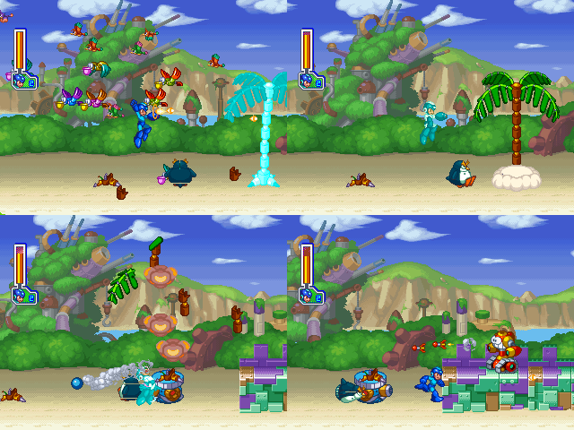

# Worked example: the Penguin (ID 05)

The Penguin only exists in STAGE01 (Frost Man). Its code is [STAGE01/05.c](STAGE01/05.c); below is a walk
through it and then through what it took to run it in the intro stage.

## The code

Everything lives in one block of STAGE01.BIN, `0x801D8550`-`0x801D9060` (11 functions, 2832 bytes), plus
0x2C bytes of data at `0x801E667C`: four hitboxes and the 5-entry state table at `0x801E6694`.

`FUN_801d8550` is the handler the main table calls every frame:

1. If it is past its init state it checks Mega Man's shots. Killed: explosion and item drop (two PSX.EXE
   calls) and the slot is freed. Hurt: it flashes (`clut = 0`) and remembers which side it was hit from
   in `field_0x59`. Otherwise it gets its CLUT back from the stage's bank table.
2. It calls `state_table[obj->state]`.
3. Physics, unless `field_0x58` is set: gravity of `0x4000` while airborne (bit 7 of `field_0x33` clear),
   friction of `0x800` per frame on `speed_x`, turn around on a wall (bits 4-5 of `field_0x33`) or when
   `FUN_801d8f20` says so, `Obj_ApplySpeed`, fall speed capped at 6 px/frame and `speed_x` at 8.
4. `FUN_801d8df8` pushes it apart from other Penguins it overlaps (same ID), then the usual PSX.EXE calls:
   terrain (`FUN_80106214`, not traced), contact damage, draw, and despawn once out of the active area.

The states:

| State | Function | What it does |
|---|---|---|
| 0 | `FUN_801d87a8` | `Enemy_InitFromTable` (bank 0x0C, 7 HP, 3 contact damage), random facing, walking animation, standing hitboxes |
| 1 | `FUN_801d8838` | Waddles. Every 30 frames the waddle speeds up a step; a hit pushes it away from the shot and slows it back down. Once it is fast enough it turns to face Mega Man and goes to 2 |
| 2 | `FUN_801d8a28` | Wind-up animation with sound 0x79; at frame 0x0D it switches to the belly-slide hitboxes; at the end of the animation, state 3 |
| 3 | `FUN_801d8b14` | Belly slide at 5 px/frame towards its facing, sound 0x7A. Friction slows it down; when it stops, sound 0x7A is stopped and it goes to 4 |
| 4 | `FUN_801d8be8` | Gets up, waits 8 frames, picks a random facing again and goes back to 1 |

`field_0x51` (frame counter), `field_0x54` (waddle speed), `field_0x55` (facing), `field_0x56` (Mega Man's
side) and `field_0x58`/`field_0x59` are the Penguin's own fields.

## Moving it to the intro stage

[Tools/mm8_inject.py](../Tools/mm8_inject.py) did this, on files extracted from the disc:

```
python3 mm8_inject.py <files> closures.json 01 00 05 <out> --spawn 900,441
python3 disc_patch.py "<original track 1>.bin" "<new track 1>.bin" <out> closures.json
```

- **Code.** STAGE01's copy of the code plus STAGE01's two data blocks (the words before its first
  function and its tail data, 5596 bytes in total) appended to STAGE00.BIN at `0x801E29B0`. 43
  instructions had an absolute address in them and were relocated: `jal`/`j` targets, and `lui` + low half
  pairs pointing at the state table and the hitboxes. Words in the copied data that point at the copied
  code (the state table) were relocated too. STAGE00's main table slot 05 now points at `0x801E29B0`.
  STAGE00.BIN grows from 43440 to 49036 bytes and ends at `0x801E3F8C`, well under `0x801F923C`.
- **Graphics.** Bank 0x0C has no frames in STAGE00.PAC. Its 1036 bytes of frames from STAGE01.PAC were
  appended to entry 5, and entries 6/7/8 got the offset, a tile base of 0xC00 and a CLUT byte. Its 105
  tiles were copied into tiles of STAGE00's entry 0x102 that no bank uses and that are blank, with the
  frames' tile numbers rewritten to match. Its two palettes went into two all-zero palette slots
  (row 1, x 14 and 15) of entry 9.
- **Enemy list.** One record `{ID 05, var 0, type 1, x 900, y 441}` added before the terminator.
- **PSX.EXE.** The size of STAGE00.BIN in the file table at `0x80136F7C`.
- **Disc.** STAGE00.BIN no longer fits its sectors, so it went into the free sectors after the last data
  file (LBA 141946) and its file-table LBA was changed. STAGE00.PAC and PSX.EXE kept their size and were
  written in place.

## Result in PCSX-Redux

Booting the patched image and walking right in the intro stage: STAGE00.BIN in RAM matched the patched
file, the Penguin spawned from its record when the camera reached x=900, took Mega Man's shots (HP 7, 5,
then 1), and went through states 1, 2 and 3 with the right graphics:



Not checked: whether the two sound effects play (they may not be in the intro stage's sound bank), and the
kill itself (Mega Man walked past it at 1 HP).
