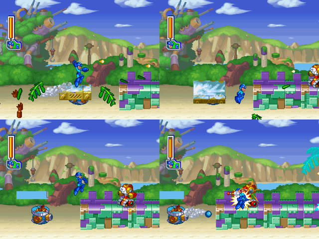

# Putting an enemy in a stage that does not have it

Every stage overlay has its own 98-entry enemy table (see [Overlays.md](Overlays.md)). An ID whose code is
not in that overlay points at a stub that frees the object on its first frame (`Obj_Free`, which leaves
the enemy-list record marked as spawned), so the enemy never shows up. Making it work needs four things in the target stage: the code, the table slot, the graphics, and an
enemy-list record. All four are files the editor already writes.

[Tools/mm8_inject.py](../Tools/mm8_inject.py) does it on extracted disc files and
[Tools/disc_patch.py](../Tools/disc_patch.py) writes the result onto a disc image. Both are plain Python 3
with no dependencies, written as a reference for doing the same in the editor. The Penguin (05) from
STAGE01 was moved into the intro stage this way and played in PCSX-Redux; see
[../Decomp/Penguin.md](../Decomp/Penguin.md). Every other enemy was only checked statically (the table in
[../Decomp/README.md](../Decomp/README.md)).

## 1. Code

What to copy, from the source overlay:

- the enemy's functions: the handler, every function in its state table and every overlay function those
  call. [Tools/closures.json](../Tools/closures.json) lists them for every enemy of every overlay
  (`funcs`: start, end, entry);
- the overlay's two data blocks, whole: the words before its first function and the data after its last
  function (`data_blocks`). Overlays have no data between functions and these blocks are small (a few KB
  at most), so copying them whole is simpler than working out which bytes one enemy uses.

Append it to the target overlay (16-byte aligned) and relocate it. Everything else in the copied code is
either PC-relative (branches) or points into PSX.EXE (the same in every stage). The things that
hold an absolute address into the source overlay are:

- `j`/`jal` instructions: rewrite the 26-bit target;
- `lui reg, hi` followed by a low half using `reg` (`addiu`, `ori`, loads and stores, also through an
  `addu reg, reg, index` for table lookups): rewrite both halves, remembering that the low half is signed
  so the high half takes the carry;
- words in the copied data that point at copied code or data (state tables, pointer tables): rewrite
  them. Words that point at code that was not copied belong to other enemies' tables and can be left
  alone.

An address is relocated by where it falls: an address inside a copied range moves by that range's
offset; one inside the source overlay but outside everything copied means the list of functions is
incomplete, so stop. The tool's `relocate()` is about 60 lines.

Then point the target's main table slot (`main_table + ID * 4`, addresses in `closures.json`) at the
relocated handler.

### How much room there is

Overlays have no BSS: nothing in any overlay uses memory past the end of its own file, and PSX.EXE only
uses memory from `0x801FC000` up in that area. The game loads overlays up to the size of STAGE0D.BIN (ending at
`0x801F923C`), so anything up to that address is free while a smaller overlay is loaded. That gives:

| Stage | Overlay ends at | Free RAM after it | Free blank tiles (0xC00-0xFFF) | Free palette slots (rows 0-3) |
|---|---|---|---|---|
| STAGE00 | 0x801E29B0 | 92300 bytes | 123 | 3 |
| STAGE01 | 0x801E711C | 74016 bytes | 11 | 7 |
| STAGE02 | 0x801E8DC8 | 66676 bytes | 122 | 3 |
| STAGE02B | 0x801E8DC8 | 66676 bytes | 43 | 11 |
| STAGE03 | 0x801EA130 | 61708 bytes | 534 | 6 |
| STAGE03B | 0x801EA130 | 61708 bytes | 51 | 3 |
| STAGE04 | 0x801E757C | 72896 bytes | 378 | 3 |
| STAGE04B | 0x801E757C | 72896 bytes | 257 | 3 |
| STAGE05 | 0x801EAE10 | 58412 bytes | 521 | 12 |
| STAGE05B | 0x801EAE10 | 58412 bytes | 451 | 14 |
| STAGE06 | 0x801E5CCC | 79216 bytes | 819 | 20 |
| STAGE06B | 0x801E5CCC | 79216 bytes | 489 | 11 |
| STAGE07 | 0x801E0CB0 | 99724 bytes | 1024 | 16 |
| STAGE07B | 0x801E0CB0 | 99724 bytes | 770 | 13 |
| STAGE08 | 0x801E1394 | 97960 bytes | 1024 | 20 |
| STAGE08B | 0x801E1394 | 97960 bytes | 680 | 13 |
| STAGE09 | 0x801DBB44 | 120568 bytes | 888 | 19 |
| STAGE0A | 0x801E21D0 | 94316 bytes | 341 | 10 |
| STAGE0B | 0x801E8884 | 68024 bytes | 313 | 5 |
| STAGE0C | 0x801EB0DC | 57696 bytes | 49 | 6 |
| STAGE0D | 0x801F923C | 0 bytes | 48 | 11 |

(The B rows are the second-half PACs; they use the same overlay.) STAGE0D has no room left, so putting
enemies there would need another free area. With the data blocks included, 80% of the enemies are
between 2.7 and 10.7 KB; the largest is 22.9 KB.

## 2. Graphics

The enemy's sprite bank is byte 0 of its row in the property table at `0x801393B4` in PSX.EXE
([EnemyTable.md](EnemyTable.md)). If the target stage's PAC already has frames and a tile base for that
bank, there is nothing to do. Otherwise, in the target PAC (and its B PAC if it has one):

- append the bank's frames from the source PAC's entry 5 to entry 5, and set the bank's entry 6 slot to
  their offset;
- copy the tiles the frames use from the source entry 0x102 into tiles of the target entry 0x102 that no
  bank uses and that are blank, and rewrite the tile number in each quad (`w & 0x3FF`) to match. The tool
  puts them under a tile base of 0xC00 (the last four texture pages) and sets entry 7 to 0xC00;
- copy the palettes (one per value of bits 11-12 used by the quads, starting at the bank's CLUT byte)
  into all-zero palette slots of entry 9, and set entry 8 to the new slot.

The frame format and the tile/CLUT encoding are in [Sprites.md](Sprites.md). Entry 5 has room for 0x26000
bytes in RAM. Free tiles and palette slots per stage are in the table above; STAGE01 and
STAGE0C are tight on tiles.

## 3. The enemy list

Add a record `{0, ID, var, type 1, x, y}` before the `0xFF` terminator in entry 0x0A, as the editor
already does. Note the spawner only checks the strip the camera is scrolling into (see
[Objects.md](Objects.md)), so the enemy appears when its position scrolls in from an edge.

## 4. PSX.EXE and the disc

The overlay grows, so its size in the file table at `0x80136F7C` (12 bytes per file, the second word is
the size) has to change, and a PAC whose entries grew past their padding changes size too. On the disc a
file that no longer fits its sectors has to move; on the USA disc there are 150 unused sectors between
the last data file and the end of track 1, and the game only reads files through that same table, so
`disc_patch.py` writes grown files there and changes their LBA in the table. The editor's own disc
rebuild can do the same job.

## Things to check per enemy

- **Child objects.** If the enemy creates other main-pool objects (projectiles, parts), those IDs need
  code in the target stage too. Some enemies create type 3 or type 4 objects whose PSX.EXE table entry is
  a fixed address inside one particular overlay; move those too, as below, when that address is free in
  the target. Both are listed per enemy in [../Decomp/README.md](../Decomp/README.md).
- **Sound effects.** Sounds are played by number. One that is not in the target stage's sound data
  probably plays something else or nothing; not checked.
- **Several versions.** 7 IDs have different code in different stages; take the version you want.
- **IDs whose code is in PSX.EXE** (00-03 and a few others) need only the graphics part.

## Items, type 3 objects and effects

The same four steps apply, with these differences.

- **Items (type 2)** dispatch through the overlay's second table (`second_table` and `second_count` in
  `closures.json`). It has 0x34 entries, but only 0x30 in STAGE02 and STAGE03, so items 30-33 have no slot
  there. Append the code and point the slot at it, as for an enemy.
- **Type 3 objects and effects (type 4)** dispatch through tables in PSX.EXE (`0x8015029C`, `0x8015039C`)
  with one entry per ID for every stage. For a stage-specific object that entry is a fixed address inside
  the overlay that owns it, so changing the entry would break the owner. Instead the copy is placed so its
  handler lands exactly on that address: lay out code and data as for an enemy, pick the start so the
  handler falls on the table address, and pad the target overlay up to it. That only works when the
  address is past the end of the target overlay (and the copy still ends before `0x801F923C`); the tool
  stops with an error otherwise. Two of these going into one stage must not overlap, and the lower one has
  to go in first.
- **Graphics.** Items and effects do not use the enemy property table. Their code sets the bank as a
  constant and reads its tile base and CLUT byte straight from entries 7 and 8 (`0x80170348 + bank * 2`,
  `0x80159F64 + bank`). `closures.json` lists those banks per object (`banks`) and the tool copies each one
  like an enemy bank.
- **Enemy-list record.** The type byte picks the pool: 2 for an item, 3 for a type 3 object, 4 for an
  effect.
- **Which stage owns a fixed address.** Several overlays can happen to have a function starting at the
  same address. The owner is the stage whose code spawns that ID or whose enemy list has it, and that is
  the one listed in [Items.md](Items.md). Type 3 ID 11 has candidates in STAGE01 and STAGE06 and nothing
  spawns it in either, so its owner is not settled.
- **What stays tied to the original stage.** Objects that call PSX.EXE `0x80102EF4` edit the stage map from
  a list picked by stage number, so in another stage they apply that stage's entry instead (the falling
  platform below leaves an intro-stage tile behind where it stood). Objects that read the stage number at
  `0x801C336E` choose an animation or behaviour from it. Both are noted per object in
  [object-handlers.json](object-handlers.json) (`stage_dependent`), along with the banks, the child objects
  and which stages each object can be moved into.

Tested in PCSX-Redux on a patched disc image, both moved from STAGE01 into the intro stage:

```
mm8_inject.py <files> Tools/closures.json 01 00 item:03 out1 --spawn 1000,441
mm8_inject.py <files + out1> Tools/closures.json 01 00 effect:09 out2 --spawn 1200,441,1
disc_patch.py <track 1> <new track 1> out2 Tools/closures.json
```

The falling platform (item 03) spawned with its own graphics, shook when Mega Man stood on it and fell
(state 1, 2, 3; y 441 to 616). Effect 09 with var 1 spawned in the effect pool and, once Mega Man came
within 0x18 of it, wrote 0x80 to `0x801B2995` and freed itself: its handler ran at `0x801E5290`, past the
intro stage's own code, which ends at `0x801E39A0` after the platform. The overlay in RAM matched the
patched file.


